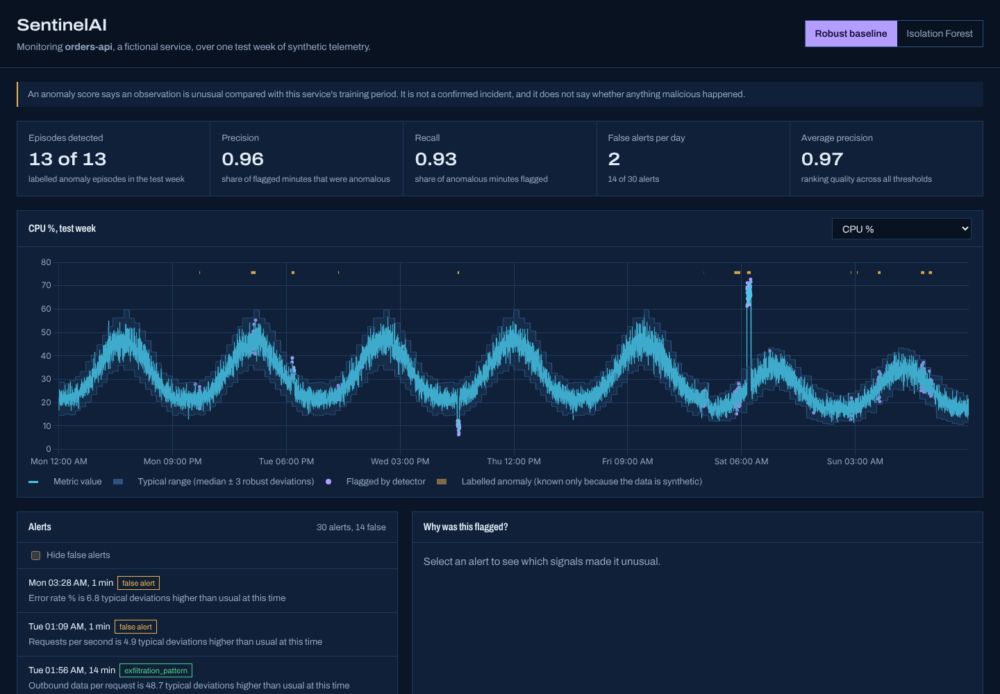
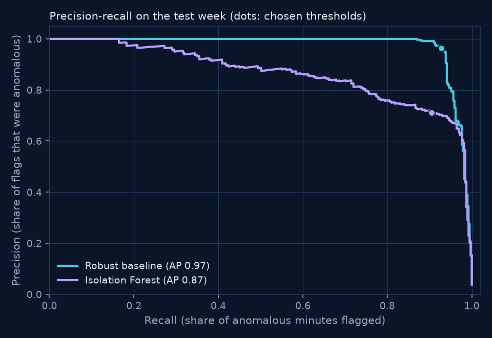
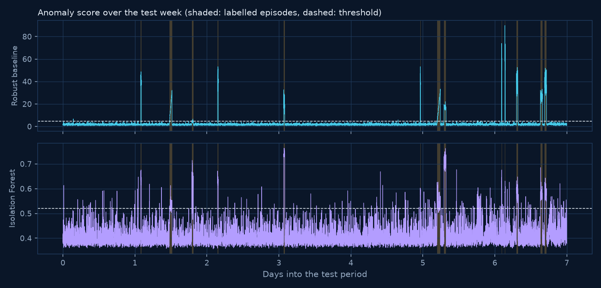
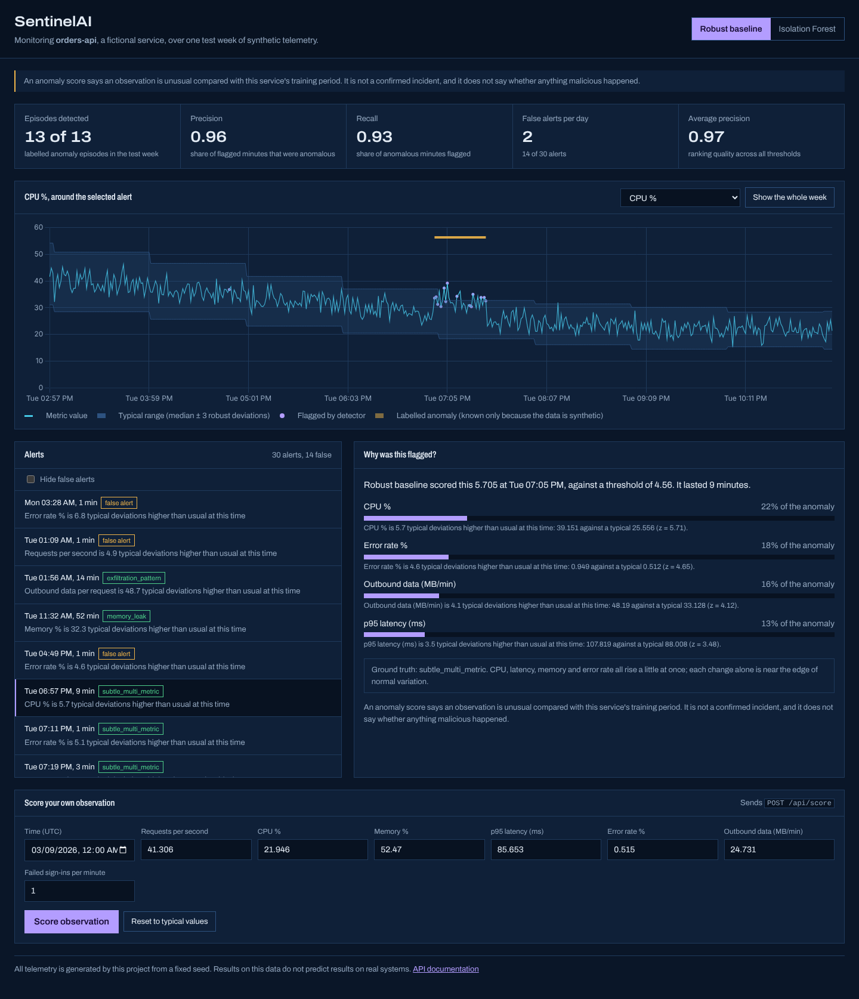
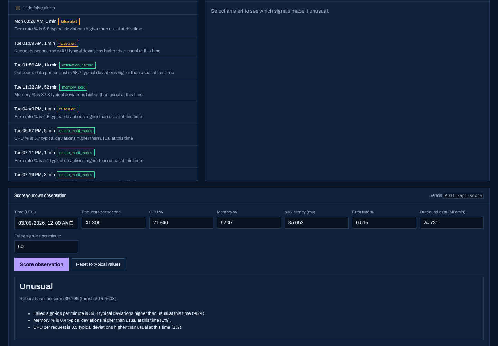
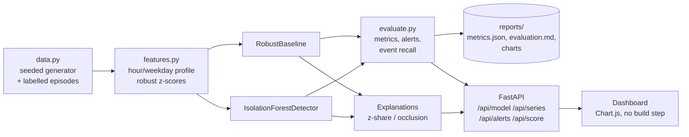

# SentinelAI

**Explainable anomaly detection for service telemetry.** SentinelAI watches seven metrics from a fictional web service, flags minutes that are unusual for the time of day and week, and shows *why* each one was flagged, signal by signal. It compares a robust statistical baseline with Isolation Forest, using metrics measured on a held-out test week.



> **Synthetic data, honest numbers.** All telemetry is generated by this project from a fixed seed. Every metric below was calculated by running the code, and CI recalculates them on every push. An anomaly score is a prompt to investigate, **not a confirmed incident**.

## The problem

Monitoring teams face two opposite failures: alerts that fire constantly, and alerts that fire without saying why. SentinelAI is built around three ideas:

1. **"Unusual" depends on time.** 120 requests a second is normal at 13:00 on a Tuesday and alarming at 03:00 on a Sunday. Every feature is scored against its own hour-of-day profile, kept separately for weekdays and weekends.
2. **Every alert needs an explanation.** The dashboard shows each signal's share of the anomaly, its actual value and its typical value.
3. **Evaluation must be honest.** Thresholds come from training data only, hyperparameters are tuned on a separate validation set, and the results are reported across several random datasets, with their limitations.

**Intended users:** SREs and security monitoring analysts triaging alerts, and engineers judging whether a detector is worth adopting.

## Results

Test week of seed 42 (13 labelled anomaly episodes, 389 anomalous minutes out of 10,080):

| | Robust baseline | Isolation Forest |
|---|---|---|
| F1 (per minute) | **0.945** | 0.796 |
| Average precision (PR-AUC) | **0.975** | 0.866 |
| Episodes detected | 13 of 13 | 13 of 13 |
| False alerts per day | **2.0** | 17.6 |
| F1 across 4 other datasets | 0.90 to 0.95 | 0.74 to 0.83 |

**The simple baseline wins on this data.** Most injected anomalies push one metric far from normal, which is exactly what the baseline measures. Isolation Forest finds the same episodes but raises many more one-minute false alerts. The full analysis, and the reasons not to read too much into synthetic results, are in the [model card](docs/model-card.md) and [reports/evaluation.md](reports/evaluation.md).

<p>


</p>

## Features

- **Reproducible synthetic dataset:** 14 days of one-minute telemetry with daily and weekly cycles, correlated metrics, and 8 labelled anomaly types: CPU runaway, memory leak, latency degradation, error burst, traffic drop, exfiltration-like outbound data, sign-in brute force, and a subtle multi-metric drift.
- **Feature engineering:** robust z-scores against per-hour, weekday-or-weekend profiles, plus ratio features (outbound data per request, CPU per request).
- **Two detectors with one interface,** and a threshold rule that's robust to contaminated training data.
- **Feature-level explanations:** z-score shares for the baseline, and occlusion attribution for Isolation Forest.
- **Evaluation:** per-minute precision, recall, F1, PR-AUC and ROC-AUC, plus what an on-call engineer feels: episodes detected, detection delay and false alerts per day.
- **REST API** to score new observations and retrieve alerts, series and model information.
- **Dashboard** with a telemetry chart against its typical range, the alert list, a "why was this flagged?" panel, and a form to score your own observation.

<table>
<tr>
<td></td>
<td></td>
</tr>
</table>

## Architecture



| Module | Responsibility |
|---|---|
| `sentinel/data.py` | Synthetic telemetry and anomaly injection |
| `sentinel/features.py` | Profiles and robust z-scores, fitted on training data only |
| `sentinel/detectors.py` | Both detectors, thresholds and explanations |
| `sentinel/evaluate.py` | Alert grouping, metrics and the Markdown report |
| `sentinel/report.py` | Evaluation run, seed sensitivity and charts |
| `sentinel/tuning.py` | Hyperparameter search on the validation dataset |
| `sentinel/engine.py` / `api.py` | Precomputed state and HTTP API |
| `sentinel/static/` | Dashboard (HTML, CSS, JS, and vendored Chart.js) |

## Run it locally

Requirements: Python 3.11 or newer.

```bash
git clone https://github.com/<your-username>/sentinelai.git
cd sentinelai
python -m venv .venv && source .venv/bin/activate
pip install -r requirements.txt && pip install -e ".[dev]"

python -m sentinel evaluate        # trains, evaluates, writes reports/ (about 10 s)
python -m sentinel serve           # dashboard on http://127.0.0.1:8000
python -m sentinel tuning          # re-run the validation hyperparameter search
```

The models are trained from the seeded data when the server starts, which takes a few seconds, so there are no model files to download.

### Score your own data

```bash
curl -s -X POST localhost:8000/api/score -H 'content-type: application/json' -d '{
  "model": "robust_baseline",
  "observations": [{"timestamp": "2026-03-10T13:00:00Z", "requests_per_s": 118, "cpu_pct": 46,
    "memory_pct": 55, "p95_latency_ms": 98, "error_rate_pct": 0.5, "net_out_mb": 70, "failed_logins": 75}]
}'
# "is_anomalous": true, with top factor "Failed sign-ins per minute is ... typical deviations higher than usual at this time"
```

Interactive API docs are at `/api/docs`. Inputs are validated: unknown fields, out-of-range values (such as CPU above 100%), and batches over 1,000 observations are rejected with 422.

### Docker

```bash
docker build -t sentinelai .
docker run -p 8000:8000 sentinelai
```

## Testing and CI

```bash
pytest --cov=sentinel     # 47 tests
ruff check . && mypy sentinel
```

The tests check that:

- the generator is reproducible and its labels are correct
- the profiles use training data only (no leakage)
- the threshold rule holds up against contamination
- anomalies outrank normal minutes
- explanations point at the injected signal for each anomaly type
- explanation shares sum to 1, and Isolation Forest is reproducible
- the metrics agree with scikit-learn
- the API validates its input
- a regression floor on F1 and average precision holds

[CI](.github/workflows/ci.yml) runs lint, strict mypy, `pip-audit` and the tests. It then **re-runs the full evaluation and fails if the results differ from the committed report**, so the numbers in this README can't drift from the code. Finally, it builds the container and smoke-tests it.

## Deployment

The service is one container with no external state, so a free [Render](https://render.com/docs/free) web service works: create a web service from the repository with the Docker runtime. Free instances sleep after 15 minutes without traffic and take about a minute to wake. The models then retrain at start-up, which adds a few seconds. The running service uses about 230 MB of memory (measured locally).

## Security and responsible use

- The service is read-only apart from `/api/score`, which only computes a result and stores nothing.
- Strict input validation (Pydantic, `extra="forbid"`, ranges and batch limits).
- A Content Security Policy that allows scripts only from the service itself. Chart.js is vendored, not loaded from a CDN.
- Every response that contains scores carries a disclaimer that an anomaly isn't an incident. Ground-truth labels appear only because the data is synthetic.
- This is monitoring and analytics only. It doesn't scan, probe or interact with any system.

## Limitations

- Synthetic data. Real telemetry has drift, deployments, gaps and anomaly shapes this generator doesn't model.
- The profiles are fitted once, so there's no retraining or drift detection.
- Results are somewhat optimistic, because the threshold rule was chosen during development with test results visible (see the [model card](docs/model-card.md)).
- Explanations describe what the model reacted to, not the root cause.
- Single service only. There's no multi-host correlation or seasonality beyond daily and weekly.

## Roadmap

- A rolling retraining window, with anomaly-aware exclusion from the baseline
- Threshold calibration to a false-alert budget, set on validation data
- A forecasting-based detector (residuals from a seasonal model) as a third comparison
- Importing real metrics from Prometheus exports, with the same evaluation harness

## License

MIT. See [LICENSE](LICENSE). Chart.js is MIT-licensed (`sentinel/static/vendor/chartjs-LICENSE.md`), and the Archivo font is under the SIL Open Font License.
